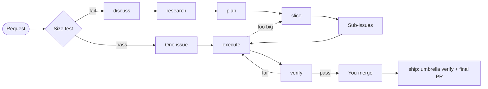

# Engineering process

This is the contract between the phases of the engineering plugin. Each phase gets inputs, gives outputs, stores them in one known place, has one exit gate, and has defined points where it stops and asks you.

The decisions behind the contract are in [docs/adr/](../adr/README.md). Lines marked **v0** describe the walking skeleton. Everything not marked v0 comes in a later stage.

## Words

| Term | Meaning |
|---|---|
| **Request** | A sentence, an issue or a bug report that starts work. |
| **Size test** | The test of whether one issue fits one session (see below). |
| **Shape** | discuss → research → plan → slice. It turns a request into issues. |
| **Build** | execute → verify → merge, once for each issue, then ship. |
| **Umbrella issue** | The one record of a feature: goal, scenarios, decisions, out of scope. |
| **Sub-issue** | One session of work under an umbrella issue. |
| **Scenario** | One acceptance criterion as `WHEN … THEN …`. Each scenario becomes a test. |
| **Feature branch** | The branch of an umbrella issue. Sub-issue PRs merge into it. |
| **Final PR** | The one PR that takes a feature branch into `main`. |

## Flow



## Size test

An issue fits one session when all four are true:

1. It delivers one behaviour that you can demo or test alone.
2. One verify command proves it, and that command fails before the work.
3. After a short read of the code, the agent can name every file it changes.
4. It has no open design question for you.

The test runs at three points:
- **Intake:** a request that passes goes straight to Build. A request that fails goes to Shape.
- **slice:** each sub-issue must pass. A sub-issue that fails is split again.
- **execute:** if the agent finds a failure, it stops and sends the issue back to slice.

## Phases

### discuss (Shape)
- **Gets:** a request, the code, `docs/adr/`.
- **Gives:** an umbrella issue in the format below.
- **Stores in:** GitHub.
- **Exit gate:** no open question remains, and you confirm the scenarios.
- **v0:** question rounds. Each round asks every question whose prerequisites are settled. Each question has a recommended answer that "yes" accepts.
- **Later:** the unknowns map, ADRs and the glossary.

### research (Shape, not in v0)
- **Gets:** the umbrella issue, the code, the web.
- **Gives:** one comment on the umbrella issue with cited notes.
- **Exit gate:** each known unknown has an answer with a source, or is marked open.
- **Stops for:** a finding that changes a scenario. That goes back to discuss.

### plan (Shape)
- **Gets:** the umbrella issue and the research comment.
- **Gives:** a plan page (ADR-003). Your answers go into the umbrella's Decisions section.
- **Exit gate:** every decision has an answer.
- **v0:** a `## Design` section in the umbrella issue (modules, seams, data shapes). No page.

### slice (Shape; plan calls it, and execute calls it under rule 5)
- **Gets:** the umbrella issue with its design and decisions.
- **Gives:** the feature branch `<n>-<slug>` from `main`, plus sub-issues in the format below, with parent links and "blocked by" links.
- **Exit gate:** every umbrella scenario belongs to at least one sub-issue, and every sub-issue passes the size test.
- **Stops for:** a scenario that no sub-issue can own. That goes back to plan.

### execute (Build)
- **Gets:** one ready issue and `docs/agents/commands.md`.
- **Gives:** a worktree, a branch `<n>-<slug>` taken from the feature branch (from `main` for a one-session issue), commits, and a draft PR into that same base branch.
- **Exit gate:** the issue's verify command passes, then execute calls verify.
- **Deviation rules:**
  1. A bug in the way of the issue: fix it, and name the fix in the PR.
  2. A missing guard that the issue needs: add it, and name it in the PR.
  3. A broken check or tool that blocks the issue: fix it.
  4. A change to the architecture or to a scenario: stop and ask.
  5. The issue fails the size test: stop, and call slice.
- **Later:** inject the issue and the commands through scripts (ADR-004), and add `status: in progress`.

### verify, issue scope (Build; execute calls it)
- **Gets:** the PR and the scenarios of its issue.
- **Gives:** one PR comment. For each scenario it records exists, substantive and wired, with evidence, then gives a verdict.
- **On pass:** it marks the PR ready.
- **On fail:** it returns to execute with the report.
- **Rule:** a fresh-context agent that did not write the code. A summary is a claim, not evidence.
- **Later:** `status: needs review` on pass.

### merge (you)
You review the sub-issue PR and merge it into the feature branch. For a one-session issue, you merge into `main`, and `Closes #n` closes the issue.

### verify, umbrella scope (Build; ship calls it)
- **Gets:** the umbrella's scenarios and the feature branch.
- **Gives:** one comment on the umbrella issue. Each gap goes to slice, which opens a new sub-issue.
- **Exit gate:** every umbrella scenario passes.

### ship (Build)
- **Gets:** an umbrella issue whose sub-issue PRs have all merged into the feature branch.
- **Does:**
  1. Merges `main` into the feature branch, by merge and not rebase.
  2. Runs umbrella-scope verify.
  3. Opens the final PR into `main`.
- **Gives:** a ready final PR. Its body has one `Closes #n` line for each sub-issue and one for the umbrella.
- **Exit gate:** umbrella verify passes and CI passes. You merge.
- **Later:** delete the plan page after you confirm, and propose one change to the setup.

### next (not in v0)
- **Gets:** GitHub and git, through `status.sh`, which runs before the model reads the skill.
- **Gives:** the current issue, the ready, review and blocked issues, and one suggested command. It also repairs any label that differs from the derived status.
- **v0:** `gh issue list` is enough.

## Status

Each status is derived from facts that GitHub and git record. Only automation writes labels (ADR-001). v0 uses no labels.

| Facts on an open issue | Status | Label |
|---|---|---|
| a "blocked by" link to an open issue | blocked | none (GitHub shows a Blocked icon) |
| its PR merged into the feature branch | merged | `status: merged` (proposed) |
| a ready PR (not a draft) | needs review | `status: needs review` |
| a linked branch or a draft PR | in progress | `status: in progress` |
| none of these | ready | none |

A closed issue is done. Its labels do no harm.

## Formats

### Umbrella issue
```markdown
## Goal
<one sentence: who can do what>

## Scenarios
- WHEN <condition> THEN <result>

## Decisions
- D1 · <decision> (<ADR link if one exists>)

## Design            ← v0 only; later the plan page
<modules, seams, data shapes>

## Out of scope
- <item>
```

### Sub-issue
```markdown
Sub-issue of #<umbrella> · Blocked by #<n>      ← GitHub links, not text, where possible

## What it delivers
<one behaviour>

## Scenarios
- WHEN <condition> THEN <result>

## Files
<paths>

## Verify
<one command that fails before the work and passes after it>
```

### Final PR body
```markdown
<one paragraph: what the feature does>

Closes #<sub-issue>
Closes #<sub-issue>
Closes #<umbrella>
```

## Open items
- **Spike (stage 0), partly done on 2026-10-12:**
  - **Done:** `gh` 2.101.0 on the host gives `parent`, `subIssues`, `subIssuesSummary`, `blockedBy`, `blocking` and `closedByPullRequestsReferences` as `--json` fields. `gh issue develop --list <n>` gives the linked branches.
  - **Open:** cargus-forge is public, so the same check must run on one of your private repos.
  - **Open:** confirm that the Blocked icon shows on your GitHub plan.
  - **Open:** confirm that a `!`cmd`` script runs under Remote Control.
- **The `status: merged` label:** propose to keep it, or show the state only in `next`.
- **Verify commands for skills:** a skill has no test command until evals are settled. Sub-issues of the skeleton need one, so the evals discussion comes before slice.
- **html-plan install:** test whether the `claude-community` marketplace must be added first.
