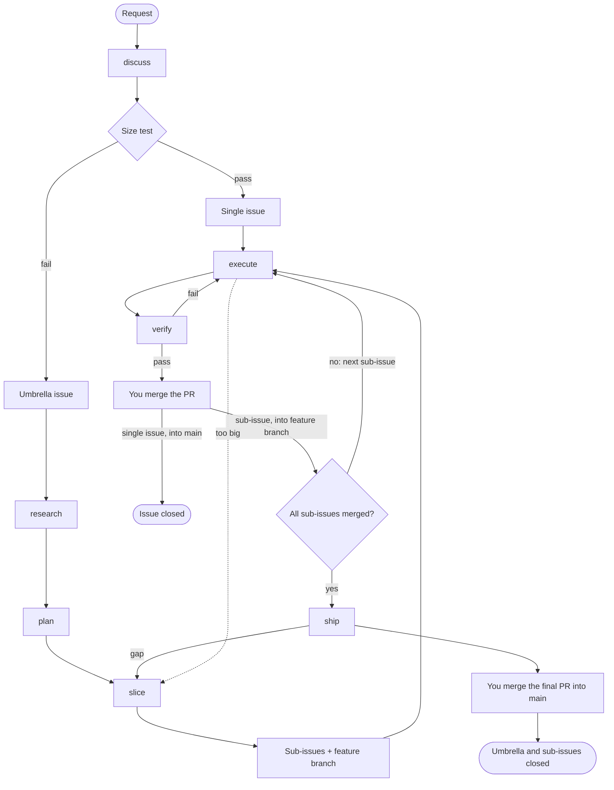

# Engineering process

This is the contract between the phases of the engineering plugin. Each phase gets inputs, gives outputs, stores them in one known place, has one exit gate, and has defined points where it stops and asks you.

The decisions behind it are in [docs/adr/](../adr/README.md). Lines marked **v0** describe the walking skeleton. Everything not marked v0 comes in a later stage.

## Words

| Term | Meaning |
|---|---|
| **Request** | A sentence, an issue or a bug report that starts work. |
| **Size test** | The test of whether one issue fits one session (see below). |
| **Shape** | discuss → research → plan → slice. It turns a request into issues. |
| **Build** | execute → verify → merge, once for each issue. For an umbrella, ship comes last. |
| **Issue** | One session of work. It is either a single issue (no umbrella) or a sub-issue. |
| **Umbrella issue** | The one record of a feature that needs more than one session: goal, scenarios, decisions, out of scope. |
| **Sub-issue** | An issue under an umbrella issue. |
| **Scenario** | One acceptance criterion as `WHEN … THEN …`. Each scenario becomes a test. |
| **Feature branch** | The branch of an umbrella issue. Sub-issue PRs merge into it. |
| **Final PR** | The one PR that takes a feature branch into `main`. ship opens it. |

## Flow



## Size test

An issue fits one session when all four are true:

1. It delivers one behaviour that you can demo or test alone.
2. One verify command proves it, and that command fails before the work.
3. After a short read of the code, the agent can name every file it changes.
4. It has no open design question for you.

The test needs scenarios and settled questions, so **discuss always comes first**. The test then runs at three points:
- **The end of discuss.** If the request passes, discuss writes a single issue and you go to Build. If it fails, discuss writes an umbrella issue and you go on with Shape.
- **slice.** Each sub-issue must pass. A sub-issue that fails is split again.
- **execute.** If the agent finds a failure, it stops and sends the issue back to slice.

An issue that already has scenarios and passes the test skips discuss. Sub-issues from slice are like this.

## Phases

### discuss (Shape)
- **Gets:** a request, the code, `docs/adr/`.
- **Gives:** a single issue if the size test passes, or an umbrella issue if it fails. Both use the formats below.
- **Stores in:** GitHub.
- **Exit gate:** no open question remains, you confirm the scenarios, and the size test has a result.
- **Depth fits the request.** A small request needs one or two rounds. discuss stops when the size test can be answered and passes. A request that fails the test gets full rounds.
- **v0:** question rounds. Each round asks every question whose prerequisites are settled. Each question has a recommended answer that "yes" accepts.
- **Later:** the unknowns map, ADRs and the glossary.

### research (Shape, not in v0)
- **Gets:** the umbrella issue, the code, the web.
- **Gives:** one comment on the umbrella issue with cited notes.
- **Exit gate:** each known unknown has an answer with a source, or is marked open.
- **Stops for:** a finding that changes a scenario. That goes back to discuss.

### plan (Shape)
- **Gets:** the umbrella issue and the research comment.
- **Gives:** a plan page (ADR-003). Your answers go into the umbrella's Decisions section.
- **Exit gate:** every decision has an answer.
- **v0:** a `## Design` section in the umbrella issue (modules, seams, data shapes). No page.

### slice (Shape; plan calls it, and execute calls it under rule 5)
- **Gets:** the umbrella issue with its design and decisions.
- **Gives:** the feature branch `<n>-<slug>` from `main`, plus sub-issues in the format below, with parent links and "blocked by" links.
- **Exit gate:** every umbrella scenario belongs to at least one sub-issue, and every sub-issue passes the size test.
- **Stops for:** a scenario that no sub-issue can own. That goes back to plan.

### execute (Build)
- **Gets:** one ready issue and `docs/agents/commands.md`.
- **Gives:** a branch linked to the issue with `gh issue develop`, commits, and a draft PR. The base is the feature branch for a sub-issue, and `main` for a single issue.
- **Branch name:** `docs/agents/issue-tracker.md` sets the pattern for each repo, for example `feature/<n>-<slug>`. The default is `<n>-<slug>`, which is the form `gh issue develop` makes.
- **Worktree:** execute uses the session's worktree and does not make a second one.
  1. The session is in a worktree on its own new branch, with no commits and no changes. Remote Control names these `.claude/worktrees/bridge-cse_<id>` on the branch `worktree-bridge-cse_<id>`. execute switches that worktree to the issue branch and deletes the unused branch.
  2. The session is already on `<n>-<slug>` for this issue. execute resumes the work.
  3. The session is in a worktree that holds other work. execute stops and asks you.
  4. The session is not in a worktree. execute enters a new one, then follows step 1.
  - The directory name stays the same, because moving the directory of a running session breaks it.
  - execute asks you to name the session with `/rename <n>-<slug>`, which also works from the phone.
- **Exit gate:** the issue's verify command passes, then execute calls verify.
- **Deviation rules:**
  1. A bug in the way of the issue: fix it, and name the fix in the PR.
  2. A missing guard that the issue needs: add it, and name it in the PR.
  3. A broken check or tool that blocks the issue: fix it.
  4. A change to the architecture or to a scenario: stop and ask.
  5. The issue fails the size test: stop, and call slice.
- **Later:** inject the issue and the commands through scripts (ADR-004), and add `status: in progress`.

### verify, issue scope (Build; execute calls it)
- **Gets:** the PR and the scenarios of its issue.
- **Gives:** one PR comment. For each scenario it records exists, substantive and wired, with evidence, then gives a verdict.
- **On pass:** it marks the PR ready.
- **On fail:** it returns to execute with the report.
- **Rule:** a fresh-context agent that did not write the code. A summary is a claim, not evidence.
- **Later:** `status: needs review` on pass.

### merge (you)
You review the PR and merge it. A sub-issue PR merges into the feature branch, and its issue stays open until the final PR. A single-issue PR merges into `main`, and `Closes #n` closes the issue.

### ship (Build, for an umbrella issue)
- **Gets:** an umbrella issue whose sub-issue PRs have all merged into the feature branch.
- **Does:**
  1. Merges `main` into the feature branch, by merge and not rebase.
  2. Runs verify on the umbrella scope (below).
  3. Opens the final PR from the feature branch into `main`.
- **Gives:** a ready final PR. Its body has one `Closes #n` line for each sub-issue and one for the umbrella.
- **Exit gate:** umbrella verify passes and CI passes.
- **Then:** you merge the final PR, and GitHub closes the umbrella and every sub-issue.
- **Later:** delete the plan page after you confirm, and reflect (below).

### verify, umbrella scope (Build; ship calls it)
- **Gets:** the umbrella's scenarios and the feature branch.
- **Gives:** one comment on the umbrella issue. Each gap goes to slice, which opens a new sub-issue. ship stops until that sub-issue is merged.
- **Exit gate:** every umbrella scenario passes.

### reflect (not in v0)
Runs once for each piece of work that lands on `main`: in ship for an umbrella, and at the end of execute for a single issue.
- **Gives:** zero or more proposals to change the setup, such as a rule, a check, a line in `docs/agents/`, or an ADR.
- **Evidence:** each proposal names its evidence from this work. That is a repeated correction, a failed check that a rule could have stopped, or a command that the agent had to find twice.
- **No evidence means no proposal.** "No setup change" is a normal result, not a failure.

### next (not in v0)
- **Gets:** GitHub and git, through `status.sh`, which runs before the model reads the skill.
- **Gives:** the current issue, the ready, review and blocked issues, and one suggested command. It also repairs any label that differs from the derived status.
- **v0:** `gh issue list` is enough.

## Status

Each status is derived from facts that GitHub and git record. Only automation writes labels (ADR-001). v0 uses no labels.

| Facts on an open issue | Status | Label |
|---|---|---|
| a "blocked by" link to an open issue | blocked | none (GitHub shows a Blocked icon) |
| its PR merged into the feature branch | merged | `status: merged` (proposed) |
| a ready PR (not a draft) | needs review | `status: needs review` |
| a linked branch or a draft PR | in progress | `status: in progress` |
| none of these | ready | none |

A closed issue is done. Its labels do no harm.

## Formats

### Umbrella issue
```markdown
## Goal
<one sentence: who can do what>

## Scenarios
- WHEN <condition> THEN <result>

## Decisions
- D1 · <decision> (<ADR link if one exists>)

## Design            ← v0 only; later the plan page
<modules, seams, data shapes>

## Out of scope
- <item>
```

### Issue (single issue or sub-issue)
```markdown
Sub-issue of #<umbrella> · Blocked by #<n>      ← sub-issues only; GitHub links, not text, where possible

## What it delivers
<one behaviour>

## Scenarios
- WHEN <condition> THEN <result>

## Files
<paths>

## Verify
<one command that fails before the work and passes after it>
```

### Final PR body
```markdown
<one paragraph: what the feature does>

Closes #<sub-issue>
Closes #<sub-issue>
Closes #<umbrella>
```

## Open items
- **Spike (stage 0), partly done on 2026-10-12:**
  - **Done:** `gh` 2.101.0 on the host gives `parent`, `subIssues`, `subIssuesSummary`, `blockedBy`, `blocking` and `closedByPullRequestsReferences` as `--json` fields. `gh issue develop --list <n>` gives the linked branches.
  - **Open:** cargus-forge is public, so the same check must run on one of your private repos.
  - **Open:** confirm that the Blocked icon shows on your GitHub plan.
  - **Open:** confirm that a `!`cmd`` script runs under Remote Control.
- **The `status: merged` label:** keep it, or show the state only in `next`.
- **Verify commands for skills:** a skill has no test command until evals are settled. Sub-issues of the skeleton need one, so the evals discussion comes before slice.
- **html-plan install:** test whether the `claude-community` marketplace must be added first.
- **Worktree commands:** Claude Code blocks git commands that it cannot confirm stay inside the worktree. execute must use plain, separate git commands. Test this in the skeleton.
- **Worktree cleanup:** worktrees stay after their work merges. On 2026-10-12, feederer had 6 Remote Control worktrees, including one with a detached HEAD and one that was locked. homelab-docker had 3. The proposal for a later stage: `next` lists each worktree whose branch has merged or whose issue is closed, and removes it after you confirm. It never removes a worktree that has uncommitted work.
