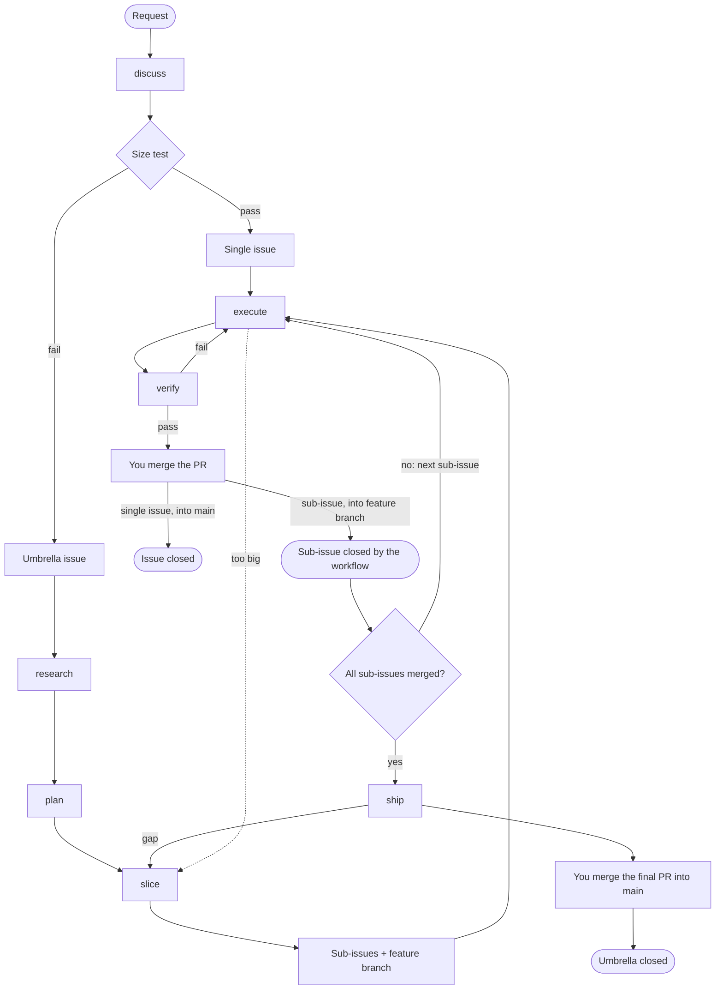

# Engineering process

This is the contract between the phases of the engineering plugin. Each phase gets inputs, gives outputs, stores them in one known place, has one exit gate, and has defined points where it stops and asks you.

The decisions behind it are in [docs/adr/](../adr/README.md). Lines marked **v0** describe the walking skeleton. Everything not marked v0 comes in a later stage.

**Role since v0.** The skills in `plugins/engineering/skills/` and the files in `plugins/engineering/references/` now hold the process that is built, the v0 skills and next, and they win where this file differs. This file stays as the design record for the stages after v0 that are not built yet (research, plan and reflect), and as the design notes that the ADRs link to. It goes once those stages are built.

## Words

The terms of this process are defined in [docs/glossary.md](../glossary.md).

## Flow



## Size test

An issue fits one session when all four are true:

1. It delivers one behaviour that you can demo or test alone.
2. One verify command proves it, and that command fails before the work.
3. After a short read of the code, the agent can name every file it changes.
4. It has no open design question for you.

If the verify command proves only part of a scenario, for example not its failure case, criterion 2 can still pass. Its verdict then names the part that the command leaves out, so you can accept the gap or change the command.

The test needs scenarios and settled questions, so **discuss always comes first**. The test then runs at three points:
- **The end of discuss.** If the request passes, discuss writes a single issue and you go to Build. If it fails, discuss writes an umbrella issue and you go on with Shape.
- **slice.** Each sub-issue must pass. A sub-issue that fails is split again.
- **execute.** If the agent finds a failure, it stops and pushes the work. A sub-issue goes back to slice, which narrows it and creates sub-issues for the rest. A single issue goes back to discuss.

An issue that already has scenarios and passes the test skips discuss. Sub-issues from slice are like this.

## Phases

### discuss (Shape)
- **Gets:** a request, the code, `docs/adr/`.
- **Gives:** a single issue with `status:ready` if the size test passes, or an umbrella issue with `umbrella` and no status label if it fails. Both use the formats below.
- **Stores in:** GitHub.
- **Exit gate:** no open question remains, you confirm the scenarios, and the size test has a result.
- **Depth fits the request.** A small request needs one or two rounds. discuss stops when the size test can be answered and passes. A request that fails the test gets full rounds.
- **v0:** question rounds. Each round asks at most five questions whose prerequisites are settled, the ones that unblock others first. Each question has a recommended answer that "yes" accepts.
- **Later:** the unknowns map, ADRs and the glossary.

### research (Shape, not in v0)
- **Gets:** the umbrella issue, the code, the web.
- **Gives:** one comment on the umbrella issue with cited notes.
- **Exit gate:** each known unknown has an answer with a source, or is marked open.
- **Stops for:** a finding that changes a scenario. That goes back to discuss.

### plan (Shape)
- **Gets:** the umbrella issue and the research comment.
- **Gives:** a plan page (ADR-003). Your answers go into the umbrella's Decisions section.
- **Exit gate:** every decision has an answer.
- **v0:** a `## Design` section in the umbrella issue (modules, seams, data shapes). No page.

### slice (Shape; plan calls it, and execute calls it under rule 5)
- **Gets:** the umbrella issue with its design and decisions. From execute under rule 5: a sub-issue that fails the size test, with execute's findings.
- **Gives:** the feature branch `<n>-<slug>` from `main`, plus sub-issues in the format below, each with `status:ready`, with parent links and "blocked by" links that slice sets through REST. The `Blocked by` text in a sub-issue's first line mirrors the links for readers ([ADR-006](../adr/ADR-006-engineering-runs-in-cloud-sessions.md)).
- **Feature branch:** slice creates it with `gh issue develop`, or with `git push` and no link where GraphQL is refused. When a single issue with work so far becomes an umbrella, the branch starts from the current branch's head, not `main`, and the plan lists those commits so you can drop them (ADR-006).
- **Re-split:** slice reads the work so far from the current branch (ADR-006). The sub-issue keeps the part that is built or closest to built, and slice rewrites its body for that part. Each other part becomes a new sub-issue of the same umbrella, blocked by the narrowed sub-issue and by its blockers. Each issue that the old sub-issue blocked becomes blocked by every part. You then run execute again on the narrowed sub-issue.
- **Exit gate:** every umbrella scenario belongs to at least one sub-issue, and every sub-issue passes the size test.
- **Stops for:** a scenario that no sub-issue can own, or two parts of the umbrella that conflict, such as a Design that breaks a decision. Both go back to plan (discuss in v0), and slice does not settle them in a sub-issue.

### execute (Build)
- **Gets:** one ready issue and `docs/agents/commands.md`.
- **Gives:** an issue branch, commits, and a draft PR. The base is the feature branch for a sub-issue, and `main` for a single issue. execute finds the feature branch by its name in git, as the one remote branch that matches the pattern for the umbrella's number (ADR-006).
- **Blockers:** execute reads them from the issue's "blocked by" links only (ADR-006).
- **Issue branch:** outside a cloud session, execute makes the branch with `gh issue develop`, which links it to the issue. If that gets a GraphQL 403, execute makes it with `git push`, without a link. In a cloud session, the issue branch is the session's designated branch (ADR-006).
- **Cloud session:** execute uses the designated branch, enters no worktree and creates no `<n>-<slug>` branch. On resume, it finds the open PR whose head is the current branch and whose first line names the issue. It then fetches the base and the branch, fast-forwards the local branch with `git merge --ff-only` if it is behind, and stops and asks you if they have diverged or the fetch or fast-forward fails.
- **Branch name:** `docs/agents/issue-tracker.md` sets the pattern for each repo, for example `feature/<n>-<slug>`. The default is `<n>-<slug>`, which is the form `gh issue develop` makes.
- **Worktree:** outside a cloud session, execute uses the session's worktree and does not make a second one.
  1. The session is in a worktree on its own new branch, with no changes and no commits that are not on a remote. Remote Control names these `.claude/worktrees/bridge-cse_<id>` on the branch `worktree-bridge-cse_<id>`. execute switches that worktree to the issue branch, fast-forwards a local copy that is behind with `git merge --ff-only` (stopping to ask if it has diverged or the fetch or fast-forward fails), and deletes the unused branch.
  2. The session is already on `<n>-<slug>` for this issue. execute resumes the work. It first fetches the base and the branch, fast-forwards the local branch with `git merge --ff-only` if it is behind, and stops and asks you if they have diverged or the fetch or fast-forward fails.
  3. The session is on the umbrella's feature branch, with no changes and no commits that are not on a remote, as after discuss turns a single issue with work so far into an umbrella. execute goes on as in step 1, but keeps the feature branch.
  4. The session is in a worktree that holds other work. execute stops and asks you.
  5. The session is not in a worktree. execute enters a new one, then follows step 1.
  - The directory name stays the same, because moving the directory of a running session breaks it.
  - execute asks you to name the session with `/rename <n>-<slug>`, which also works from the phone.
- **Exit gate:** the issue's verify command passes, then execute calls verify.
- **Deviation rules:**
  1. A bug in the way of the issue: fix it, and name the fix in the PR.
  2. A missing guard that the issue needs: add it, and name it in the PR.
  3. A broken check or tool that blocks the issue: fix it.
  4. A change to the architecture or to a scenario: stop and ask.
  5. The issue fails the size test: stop, and push the work. For a sub-issue, open a draft PR whose first line names it, then call slice. A later run on the narrowed sub-issue resumes from that work and rewrites the PR's title and body (ADR-006). For a single issue, open no PR, because its branch becomes the feature branch, and send it back to discuss.
- **Status label:** once it is on the issue branch, execute sets `status:in-progress`, which replaces the issue's other status label.
- **Later:** inject the issue and the commands through scripts (ADR-004).

### verify, issue scope (Build; execute calls it)
- **Gets:** the PR, the scenarios of its issue, and the check runs on the PR's head.
- **Gives:** one PR comment. For each scenario it records exists, substantive and wired, with evidence. It then lists each check run as passed, failed or pending, and gives a verdict: FAIL if a scenario or a check failed, else PENDING if a check is pending, else PASS.
- **Checks:** it reads the check runs once, after its grading agent returns, and does not wait for them (ADR-006). A repo whose CI does not run on PRs into a feature branch has no checks on a sub-issue PR, and verify grades by the scenarios alone. The verdict is the only gate on a sub-issue PR, because feature branches have no branch protection; GitHub does not merge a draft, and verify marks a PR ready only on PASS.
- **On pass:** it marks the PR ready with `gh pr ready`. If that gets a GraphQL 403, it uses `POST pulls/<n>/ccr/ready_for_review` (ADR-006). Then it sets `status:needs-review` on the issue, which replaces its other status label.
- **On fail:** it returns to execute with the report, and execute fixes what it names.
- **On pending:** it leaves the PR a draft and changes no label. execute stops and asks you to run it again once CI has finished.
- **Rule:** a fresh-context agent that did not write the code. A summary is a claim, not evidence.

### merge (you)
You review the PR and merge it. A sub-issue PR merges into the feature branch, and the close-sub-issue workflow closes its issue (ADR-002). A single-issue PR merges into `main`, and `Closes #n` closes the issue.

### ship (Build, for an umbrella issue)
- **Gets:** an umbrella issue whose sub-issue PRs have all merged into the feature branch.
- **Does:**
  1. Merges `main` into the feature branch, by merge and not rebase.
  2. Runs verify on the umbrella scope (below).
  3. Opens the final PR from the feature branch into `main`.
- **Gives:** a ready final PR. Its body has one `Closes #n` line for each sub-issue that is still open and one for the umbrella.
- **Exit gate:** umbrella verify passes and CI passes. Where `gh pr checks --watch` is refused, ship reports the checks once and stops without waiting (ADR-006).
- **Then:** you merge the final PR, and GitHub closes the umbrella and any sub-issue that is still open.
- **Later:** delete the plan page after you confirm, and reflect (below).

### verify, umbrella scope (Build; ship calls it)
- **Gets:** the umbrella's scenarios and the feature branch.
- **Gives:** one comment on the umbrella issue. Each gap goes to slice, which opens a new sub-issue. ship stops until that sub-issue is merged.
- **Exit gate:** every umbrella scenario passes.

### reflect (not in v0)
Runs once for each piece of work that lands on `main`: in ship for an umbrella, and at the end of execute for a single issue.
- **Gives:** zero or more proposals to change the setup, such as a rule, a check, a line in `docs/agents/`, or an ADR.
- **Evidence:** each proposal names its evidence from this work. That is a repeated correction, a failed check that a rule could have stopped, or a command that the agent had to find twice.
- **No evidence means no proposal.** "No setup change" is a normal result, not a failure.

### next (you type it)
- **Gets:** GitHub and git, through `status.sh`, which the skill injects, so it runs before the model reads the skill (ADR-004). It reads the open issues and the open PRs through `gh api` REST, page by page, the remote branches with `git ls-remote --heads origin`, the "blocked by" links of each issue with a status label, the sub-issues of each umbrella, the local worktrees with `git worktree list --porcelain`, and the open and closed PRs of each issue branch. It changes nothing, exits 0 and prints an error as one `status.sh error: …` line with nothing before it.
- **Gives:** the open issues, and no PRs, in the groups Needs review, In progress, Ready to build, Blocked, Umbrellas and To shape. Each issue is in one group, by the status that the facts give (see [Status](#status)), so the report is right before any label is repaired. Within a group, the lowest number comes first.
  - Each line shows one suggested command, and a sub-issue's line names its umbrella.
  - An umbrella's line shows closed of total sub-issues, or "not sliced" when it has none, and its feature branch, found by name as execute finds it: the name for one match, "no feature branch" for none, "N feature branches: …" for several.
  - A blocked issue lists each open blocker, one level deep, with its status and suggestion. A blocker counts while its issue is open. A blocker in another repo shows as `owner/repo#n` with no status.
  - At most 20 issues show, in group order. Each group that the limit cuts gets one "and N more" line.
  - An in-progress or needs-review line whose issue has no PR and no branch notes "no branch or PR". A branch whose PR has merged does not count. An issue with several status labels and neither is grouped by its highest label. Its labels stay (see [Status](#status)), and next cannot tell whether its PR merged or a session is building it before its draft PR exists, so its line names the steps it may need: a needs-review line says to close it if its PR merged, else to execute it (`close #n if its PR merged, else /engineering:execute #n`); an in-progress line says to execute it if no session is building it (`/engineering:execute #n if no session is building it`).
  - The last line is one suggestion, the first that applies: review and merge a PR that needs review, execute the lowest issue in progress that has a branch or PR, ship an umbrella whose sub-issues are all closed, execute the lowest ready issue, discuss the lowest request. When none applies, it names each issue whose status label has no branch or PR, lowest number first, as `check #n, #m, whose status label has no branch or PR`, and only else says that nothing waits.
- **Repairs:** next repairs each label that the facts contradict, by the rules in [Status](#status), without asking. It reads the labels back after each repair, and lists each change after the report. Its `allowed-tools` pre-approve the label calls and the read-back, with `*` for the issue number. A `*` in a Bash rule matches any text, flags included, so next also registers `label-guard.sh`, a `PreToolUse` hook that makes Claude Code ask for any command those rules match that is not exactly a printed call or the read-back. Claude Code keeps a skill's hooks for the rest of the session, and the hook decides nothing for any other command.
- **Cleanup:** next lists the finished worktrees and the merged remote branches after the report, and asks once, for the whole list, before it removes the finished worktrees. It asks nothing when no worktree is finished, as in a cloud session. Cleanup is local: it never deletes a remote branch, because the cloud refuses deletes and `delete_branch_on_merge` covers most of them. The removals are not pre-approved, because a pattern for them would also allow `--force`.
  - A finished worktree is a local worktree on an issue branch, `<n>-*`, whose PR has merged, with no open PR, or whose issue is closed. It has no uncommitted work (`git status --porcelain` lists nothing) and no unpushed work (each commit is on a remote branch, or in the merged PR's head, which a squash merge keeps after GitHub deletes the remote branch).
  - Never finished: the main worktree, the worktree next runs in, a locked, bare, detached or prunable worktree, and a worktree on a `worktree-*` branch.
  - After a yes, next runs `git worktree remove '<path>'`, never with `--force`, then `git branch -D '<branch>'`, for each worktree in turn, and stops at the first call that fails. `git worktree remove` refuses a worktree with changes or untracked files, and deletes its ignored files.
  - A merged remote branch is a remote issue branch with a merged PR and no open one.
- **Output of `status.sh`:** `## Report`, with one `### <group>` per group and a last line `Next: <suggestion>`. Then `## Repairs`: `- none`, or for each repair a line `- #<n> · <change> · <fact>`, its `gh api` calls one per line, and the labels that the calls leave. Then `## Cleanup`, with two lists, each `- none` when it is empty: `### Finished worktrees`, a line `- <path> · <branch> · <fact>` per worktree with its two `git` calls one per line, and `### Merged remote branches`, a line `- <branch> · PR #<n> merged` per branch.

## Status

Each status is derived from facts that GitHub and git record. Only automation writes labels (ADR-001): discuss, slice, execute and verify each set the label of their step, as the plugin's `references/rules.md` says.

| Facts on an open issue | Status | Label | Set by |
|---|---|---|---|
| no status label and no `umbrella` label | request: needs discuss | none (the default) | — |
| discuss found that it fails the size test | umbrella | `umbrella` | discuss |
| it passed the size test | ready | `status:ready` | discuss (single issue), slice (sub-issues) |
| a "blocked by" link to an open issue | blocked | GitHub's Blocked icon; the `status:ready` label stays | — |
| an issue branch with no merged PR, or a draft PR | in progress | `status:in-progress` | execute, when it gets onto the issue branch |
| a ready PR (not a draft) | needs review | `status:needs-review` | verify, on pass |

- **The safe state is the default.** An issue that someone makes by hand has no label, so it reads as a request until discuss shapes it. An issue template can add a label, but only to issues made through the template, so nothing depends on a template.
- **Each new status label replaces the one before it,** and `umbrella` replaces every status label. A skill adds a label with `POST issues/<n>/labels`, removes each one it replaces with `DELETE issues/<n>/labels/<name>`, reads the labels back, and leaves every other label as it was. It never uses the `labels` field of a `PATCH`, which replaces every label.
- **`next` repairs each label that the facts contradict,** from the list that `status.sh` prints. A repair touches only an issue that carries a plugin label, and acts only on a fact that exists:
  - an open ready PR whose first line names the issue gives `status:needs-review`;
  - with no such PR, an open draft PR that names the issue, or a remote `<n>-*` branch with no merged PR, gives `status:in-progress`;
  - a remote branch whose PR has merged is finished work, so it gives nothing;
  - the new status label replaces the issue's other status labels, and an umbrella loses its status labels and keeps `umbrella`;
  - with no such PR and no such branch, the labels stay as they are, because a cloud session's issue is in progress before its draft PR exists;
  - a repair never adds `status:ready`, because only the size test can, and never adds `umbrella`. It touches no other label.
- **`next` lists unlabelled open issues as requests,** and suggests `discuss` for each one.
- A closed issue is done. Its labels do no harm.
- **A merged sub-issue is closed,** by the close-sub-issue workflow when its PR merges into the feature branch (ADR-002). So it needs no status of its own, and the Blocked icon clears as soon as its blocker merges.

## Formats

Use exactly the sections of the format, in its order, and add no other section. The one exception: when discuss rewrites an existing issue, it adds the original body at the end under `## Request`.

GitHub reads and writes go through `gh api` REST on every surface, with each body passed as `-F body=@<path>` (ADR-006). In a cloud session, the server adds a `---` line and a `_Generated by Claude Code_` footer to each body. The footer is not part of the last section: readers ignore it.

### Umbrella issue
```markdown
## Goal
<one sentence: who can do what>

## Scenarios
- WHEN <condition> THEN <result>

## Decisions
- D1 · <decision> (<ADR link if one exists>)

## Design            ← v0 only; later the plan page
<modules, seams, data shapes>

## Out of scope
- <item>
```

### Issue (single issue or sub-issue)
```markdown
Sub-issue of #<umbrella> · Blocked by #<a>, #<b>      ← sub-issues only; mirrors the links that slice sets (ADR-006)

## What it delivers
<one behaviour>

## Scenarios
- WHEN <condition> THEN <result>

## Decisions                                      ← optional
- D1 · <decision>
- #<umbrella> D<n>

## Files
<paths>

## Verify
<one command that fails before the work and passes after it>
```

- `## Decisions` is optional. Add it only if the issue settles something that its scenarios do not state.
- When a sub-issue depends on an umbrella decision, point to it as `#<umbrella> D<n>`. Do not copy its text. A bare `D<n>` always means a decision of the issue itself.

### Final PR body
```markdown
<one paragraph: what the feature does>

Closes #<open sub-issue>
Closes #<umbrella>
```

## Open items
- **Spike (stage 0), done on 2026-10-12:**
  - **Done:** `gh` 2.101.0 on the host gives `parent`, `subIssues`, `subIssuesSummary`, `blockedBy`, `blocking` and `closedByPullRequestsReferences` as `--json` fields. `gh issue develop --list <n>` gives the linked branches.
  - **Done:** on the private repo feederer, `gh issue list --json parent,subIssuesSummary,blockedBy` works. For example, #138 shows 2 of 2 sub-issues complete. `blockedBy` returns `{nodes, totalCount}`, with no error. No feederer issue uses "blocked by" yet.
  - **Done:** the Blocked icon shows in the GitHub web issue list, but not in the GitHub mobile app. That is acceptable.
  - **Done:** the REST search API returned 0 results for `is:blocked`, minutes after the link was set. `status.sh` reads blocked-by links through REST (ADR-006) and does not use search.
  - **Done:** a `!`cmd`` line in a skill ran under Remote Control. The model saw `gh version 2.101.0` and the branch name, not the raw command.
- **Evals: parked** until after the skeleton has run end to end. Until then, a skill's verify step is `claude plugin validate --strict` plus one manual run that you check against the scenarios. The end-to-end run on the CI umbrella is the real test.
- **html-plan install:** test whether the `claude-community` marketplace must be added first.
- **Worktree commands:** Claude Code blocks git commands that it cannot confirm stay inside the worktree. execute must use plain, separate git commands. Test this in the skeleton.
- **Worktree cleanup: built** in next (see [next](#next-you-type-it)). Worktrees stay after their work merges. On 2026-10-12, feederer had 6 Remote Control worktrees, including one with a detached HEAD and one that was locked. homelab-docker had 3. The end-to-end run on #54 confirmed the need: execute leaves the worktree and its local branch behind after the PR merges, and a session cannot remove the worktree it runs in. execute can also reuse a finished worktree for the next issue.
- **Finding the feature branch: decided** in [ADR-006](../adr/ADR-006-engineering-runs-in-cloud-sessions.md). execute, verify and ship take the one remote branch that matches the `<n>-<slug>` pattern for the umbrella's number, from `git ls-remote --heads origin`. A deleted feature branch makes them stop with a reason. `status.sh` derives the branch the same way, and `next` shows "no feature branch" on the line of an umbrella whose branch is gone.
