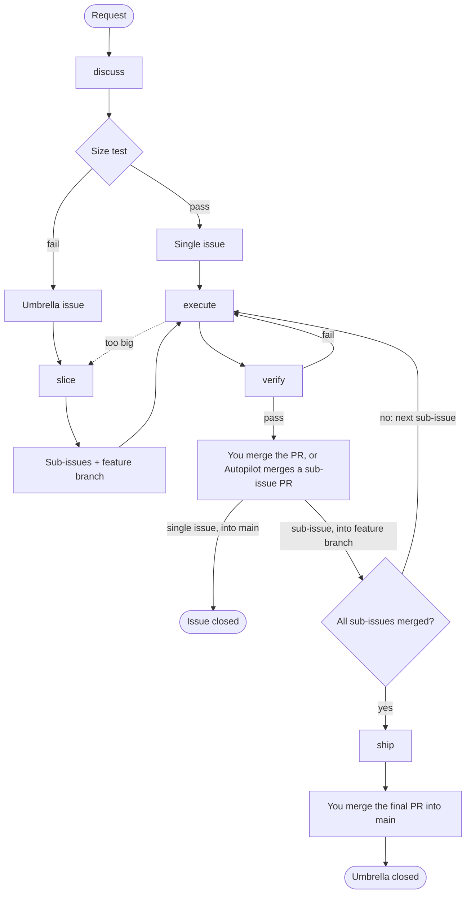

# Engineering

Set up a repo for the plugin, turn a request into GitHub issues, build each one into a verified pull request, let Autopilot build ready issues unattended, and see where each issue stands: setup, discuss, slice, execute, verify, ship, next, autopilot, autopilot-t3.

The plugin keeps its record of the work in GitHub: issues, branches and pull requests. discuss and slice write issues only after your yes. You merge every PR into `main` yourself; when you turn [Autopilot](#autopilot) on, it merges sub-issue PRs into their feature branch for you. It works in a local Claude Code session and in a Claude Code cloud session.

## Requirements

- A git repo with a GitHub remote, and `main` as its default branch.
- `gh` installed and authenticated with access to that repo. The skills read and write GitHub mostly through `gh api` REST calls, so they also work in a cloud session, where GraphQL is blocked.
- Squash merge allowed on the repo. Every PR is squash-merged.

## Setup

Install the plugin from this repo's marketplace:

```
/plugin install engineering --marketplace cstalhem/cargus-forge
```

Then run `/engineering:setup` once per repo, from its top folder. Plugin updates reach the repo without a re-run, because the plugin's own rules stay in the plugin.

- It shows what it found on one screen, then asks numbered questions, each with a recommended answer. In an interactive session you answer in a pop-up: `Apply everything recommended`, `Choose item by item` (a yes or no for each question) or `Write nothing`. Setup then writes in the same turn, so its pre-approved commands run without asking again. Where there is no pop-up, as in `claude -p`, answer `yes` to accept them all, `yes, except 2, 4` to decline some, or `no` to decline them all. You can also change a proposal, such as a row of the commands table, and setup shows it again before it writes anything.
- After your yes, it writes the repo profile, which is only `docs/agents/commands.md`: the build, test and lint commands it detected. The plugin takes `main` as the default branch, so the profile does not record it.
- It offers each optional behaviour. Today that is the close-sub-issue workflow, which closes a sub-issue as soon as its PR merges into the feature branch.
- On an existing repo, it reports what differs from the plugin's process, such as other branch names or conflicting docs, and offers one issue that lists them.
- It commits, pushes and labels nothing. It lists the files it wrote, and you commit them on a branch and open a PR.

## Commands

| Command | What it does |
|---|---|
| `/engineering:setup` | Writes the repo profile and turns on optional behaviours. |
| `/engineering:discuss <request or #issue>` | Shapes a request into one issue through question rounds: a single issue if it passes the size test, or an umbrella issue if it does not. |
| `/engineering:execute <#issue>` | Builds one issue on its branch until its verify command passes, in a draft PR it opens after its first commit. |
| `/engineering:next` | Shows where each open issue stands, from its body, links, branches and PRs, and suggests one next command. |
| `/engineering:ship <#umbrella issue>` | Takes an umbrella issue's feature branch to a ready final PR into `main`. |
| `/engineering:autopilot` | Runs Autopilot once, in a cloud session: proposes its hourly scheduled task on the first run, then builds ready issues unattended. See [Autopilot](#autopilot). |
| `/engineering:autopilot-t3` | Runs Autopilot once, in a thread on a T3 Code host: the same run with T3's scheduled task, threads and worktrees. See [Autopilot on T3 Code](#autopilot-on-t3-code). |

Two more skills run only when another skill calls them:

- `slice` splits an umbrella issue into sub-issues and creates its feature branch. discuss calls it, and execute calls it on a sub-issue that turns out too big.
- `verify` grades a PR against its issue's scenarios with a fresh-context agent and marks a passing PR ready. execute and ship call it.

discuss and execute read `references/domain-model.md` in their Load step. It holds the rules that keep the repo's domain terms in `docs/glossary.md`. They also read `references/adr.md`, which holds the rules for the repo's ADRs in `docs/adr/`: when a decision earns one, its format, and when to edit an existing ADR instead of writing a new one. discuss records each ADR as an `ADR` decision in the issue, execute writes it, and verify grades it.

## Process overview



**Shape** turns a request into issues. discuss asks questions until none is left, with a recommended answer for each. It then runs the size test: an issue fits one session when it delivers one behaviour, one verify command proves it, every file it changes can be named, and no design question is open. Work that passes becomes a single issue. Work that fails becomes an umbrella issue, which slice splits into sub-issues that each pass, on a feature branch.

**Build** takes one issue to a merged PR. execute opens a draft PR after its first commit and builds the issue on it. verify grades the PR against the issue's scenarios and marks it ready on a pass. You review and merge a single issue's PR into `main`. A sub-issue's PR goes into the feature branch: you merge it, or Autopilot does when it is on. Once every sub-issue has merged, ship opens the final PR that takes the feature branch into `main`, and you review and merge that one.

Run `/engineering:next` at any point to see where things stand and what to run next. The process terms are defined in the [glossary](../../docs/glossary.md).

## Autopilot

Autopilot is the unattended Build runner. You shape requests in discuss and review PRs into `main`; Autopilot does everything between: it builds each ready issue and each sliced umbrella issue in cloud sessions until a single issue's PR or the final PR is ready for your review. It runs only in a Claude Code cloud session, because it needs the session and scheduled task tools there, which reach a run through the `Claude_Code_Remote` connector on its scheduled task, and it stops with one line anywhere else. On a T3 Code host, `/engineering:autopilot-t3` runs the same Autopilot with T3's tools; see [Autopilot on T3 Code](#autopilot-on-t3-code).

### Turning it on

Autopilot's children are cloud sessions that inherit the environment, and a child loads the engineering plugin only when the environment provides it: the plugins synced from claude.ai do not reach a session that Autopilot starts, and a cloud session never installs a repo's `enabledPlugins` setting. Give the environment the plugin first, in the environment's settings on claude.ai:

- **This repo**, whose checkout holds the plugin's source: set the environment variable `CLAUDE_CODE_PLUGIN_DIRS` to the absolute path of `plugins/engineering` in the checkout, `/home/user/cargus-forge/plugins/engineering`. Every session in the environment then loads the plugin in place from the checkout, so a child runs the plugin at the commit it checked out, and `claude plugin list` shows it as `engineering@inline`.
- **Another repo**: add `claude plugin marketplace add cstalhem/cargus-forge` and `claude plugin install engineering@cargus-forge` to the environment's setup script. The script's result is reused for about a week, or until the script or the allowed network hosts change, so edit the script to pick up a new plugin version sooner.

Each run checks this with `claude plugin list` and stops with these instructions when the environment does not provide the plugin.

Then start a cloud session on the repo at claude.ai/code and run `/engineering:autopilot`. The first run finds no scheduled task and proposes one; it creates it only after your yes. The scheduled task's settings, as you see them in the scheduled tasks list on claude.ai:

| Setting | Value |
|---|---|
| Name | `engineering: autopilot` |
| Schedule | every hour, `0 * * * *`. The server anchors it to the minute you created it, so the runs do not all start on the hour. |
| Each run | a fresh Claude Code cloud session in the environment of the session that created it, on this repo, with the prompt `/engineering:autopilot` |
| Model | execute children run on Sonnet; the hourly run and each ship child run on the scheduled task's model, which the run that creates the scheduled task sets to its own model |
| Connector | `Claude_Code_Remote`, stored on the scheduled task. It gives each run the session and scheduled-task tools. |

A scheduled task created by hand in the claude.ai dialog stores no connector and no model, because the dialog cannot offer `Claude_Code_Remote` and has no model field, so its runs have no session tools and run on the default model. A run on such a scheduled task says so in one line and sends one push notification, and a manual run that finds an existing scheduled task without the connector or the model says what it lacks. Delete it on claude.ai and run `/engineering:autopilot` by hand, which proposes a new one.

A run reads the facts and does the Build work that is due, so a lost report or a missed answer waits at most one hour. Autopilot keeps no state of its own: the sessions it starts, the comments it posts and `status.sh` are its record.

### Pausing it

Pause or delete the scheduled task in the scheduled tasks list on claude.ai. While it is paused, no hourly run starts, and a manual `/engineering:autopilot` run says so with the scheduled task's name. Enable it again in the same list. A manual run also works with the scheduled task paused, so you can drive Autopilot by hand.

### What a run does

Each run takes these steps in order, and ends its turn when a step says so:

1. **Plugin.** The run checks with `claude plugin list` that the environment provides the engineering plugin to children, as [Turning it on](#turning-it-on) says, and stops with those instructions otherwise.
2. **Children.** A child is a session tagged `autopilot`, titled `execute #<n>` or `ship #<u>`; its title is the claim on that issue. While a child is working, the run starts nothing and ends. A child that stopped on a question gets an answer: the child's recommended answer, or the answer that changes no scenario and no decision of the issue, at most three times. execute records each answer in the PR under `## Deviations` as `Autopilot: <question> → <answer>, because <why>`, and ship gathers those lines into the final PR, so you read them at review. A child whose verify passed but could not mark its PR ready gets the PR marked ready by Autopilot.
3. **Merge.** Autopilot squash-merges each sub-issue PR that verify marked ready, one at a time, and reads back that it merged. It merges nothing else: a single issue's PR and a final PR wait for you, and execute, verify and ship still merge nothing.
4. **Ship.** When every sub-issue of an umbrella issue is done and it has no open final PR, Autopilot starts a child `ship #<u>`.
5. **Execute.** When no child is working, Autopilot starts one child `execute #<n>` for the first issue under `### Ready to build` in `/engineering:next`'s report, so sub-issues run one at a time in blocked-by order. The child runs on Sonnet, because execute is nearly all the tokens and a sized sub-issue does not need the strongest model.
6. **Review.** A ready single-issue PR or final PR without an `Autopilot: ready for your review` comment gets one, and a push notification.

A child is a cloud session on the repo with the typed prompt `/engineering:execute #<n>` or `/engineering:ship #<u>`, and one line in its system prompt that tells it to report to Autopilot's session when its turn ends: finished, stopped on a question, or stopped for another reason. The report starts the next run. A child loads the plugin from the environment it inherits, as [Turning it on](#turning-it-on) says. A child whose typed prompt did not load as a skill reports `<title>: stopped: engineering plugin not loaded in this environment` and does nothing else, and Autopilot hands the issue off.

### The four hand-offs

When Autopilot cannot go on, it hands the work to you with one comment and one push notification, and leaves it. The comment is the record: Autopilot never hands the same thing off twice. `<title>` is the child's title, `execute #<n>` or `ship #<u>`, and `<session>` its session id.

| Hand-off | Comment | Where |
|---|---|---|
| A child waits on a permission prompt | `Autopilot: stopped, <title> (<session>) waits on a permission prompt that no one can answer unattended` | the issue |
| A child asks a fourth question after three answers | `Autopilot: stopped, <title> (<session>) asked a fourth question after three answers: <question>` | the issue |
| A child stopped for another reason, such as execute sending a single issue back to discuss, or the engineering plugin not loaded in the child | `Autopilot: stopped, <title> (<session>) stopped: <reason>` | the issue |
| A single issue's PR or a final PR is ready | `Autopilot: ready for your review: PR #<pr>, <title>, for #<n>.` | the PR |

Open the session the comment names to see what the child did, answer it there, or fix the issue and run `/engineering:execute #<n>` yourself. Autopilot leaves a handed-off issue alone: the child session keeps its claim on the issue, so no later run starts another child for it.

## Autopilot on T3 Code

`/engineering:autopilot-t3` is Autopilot on a [T3 Code](https://github.com/pingdotgg/t3code) host: a machine that runs `t3` as a service, with this repo as one of its projects. The run is the same as [Autopilot](#autopilot), from the facts step to the hand-offs, and only the platform layer changes: a T3 scheduled task starts each hourly run as a fresh thread in its own worktree, the `t3-code` MCP tools, which T3 gives every thread, replace the cloud session tools, each child is a thread in its own worktree, and the child's report instruction is a queued message instead of a line in its system prompt. The skill runs only in a T3 Code thread, where the `orchestrator_capabilities` tool is in its tools, and stops with one line anywhere else.

### Preparing the host

1. Install T3 Code and run `t3` as a service, so the host runs scheduled tasks while no one watches it.
2. Run `gh auth login` on the host as the user that runs `t3`, with access to the repo. The skills read and write GitHub through `gh api`.
3. Install the plugin on the host: `claude plugin marketplace add cstalhem/cargus-forge` and `claude plugin install engineering@cargus-forge`. Each run checks with `claude plugin list` that an installed copy is there, because a child thread loads the plugin from it, and stops with these two commands otherwise. The plugins synced from claude.ai do not reach a thread that T3 starts.
4. Add the repo as a T3 project, with `main` as its base ref. Each run and each child works in a worktree from `main` on the remote.
5. In the project's settings, set the worktree cleanup to remove settled worktrees. The hourly run and every child are threads in their own worktrees, so the cleanup keeps the host from filling up.

Then open a thread on the project and run `/engineering:autopilot-t3`, on the model and in the runtime mode you want for the hourly run: the scheduled task inherits both from the thread that creates it. The first run finds no scheduled task and proposes one; it creates it only after your yes. The scheduled task's settings, as you see them in T3's scheduled tasks list:

| Setting | Value |
|---|---|
| Title | `engineering: autopilot` |
| Schedule | every hour: an interval of 3600000 ms, counted from the moment it was created |
| Each run | a fresh thread in its own worktree from the project's base ref, with the prompt `/engineering:autopilot-t3` |
| Model and modes | this thread's model, runtime mode and interaction mode, inherited when the task was created. The hourly run and each ship child run on them; each execute child runs on Sonnet. |

Pause or delete the scheduled task in that list. A run that finds it paused, or blocked by a policy, says so in one line with the task's title and goes on, so you can drive Autopilot by hand in a thread of your own with the task paused.

### What a T3 run does

Each run renames its thread to `autopilot <ISO timestamp>`, so the hourly runs are told apart in the thread list, and takes the steps of [What a run does](#what-a-run-does) with T3's tools:

- A child is a thread titled `execute #<n>` or `ship #<u>`; its title is the claim on that issue. Each child is launched in its own worktree from `main` on the remote, in `full-access` runtime mode, because no one answers an approval prompt unattended. An execute child runs on the current Sonnet model of the run's provider; a ship child inherits the run's model.
- Right after the launch, the child gets one queued message that tells it to report to the run's thread when its work ends: `<title>: finished`, `<title>: stopped on a question` or `<title>: stopped: <reason>`, with the PR and, for a question, its recommended answer. The report arrives as a message in the run's thread and starts the next run.
- A child that stopped on a question gets an answer, at most three times, through its pending request and a queued message that starts with `Autopilot: answer <k> of 3`. A child whose verify passed but could not mark its PR ready gets the PR marked ready by Autopilot.
- Autopilot merges each ready sub-issue PR, starts ship and execute children one at a time, and comments on a ready single-issue PR or final PR, as in a cloud session.

T3 Connect sends the push notifications: it pushes to your devices when a thread finishes, fails or asks, so the run sends none of its own.

### The three hand-offs

A hand-off is one comment, and the comment is the record: Autopilot never hands the same thing off twice. `<title>` is the child's title and `<thread>` its thread id. Children run in `full-access` mode, so the permission-prompt hand-off of a cloud session has no T3 case.

| Hand-off | Comment | Where |
|---|---|---|
| A child asks a fourth question after three answers | `Autopilot: stopped, <title> (<thread>) asked a fourth question after three answers: <question>` | the issue |
| A child stopped for another reason, such as execute sending a single issue back to discuss, or the engineering plugin not loaded in the child | `Autopilot: stopped, <title> (<thread>) stopped: <reason>` | the issue |
| A single issue's PR or a final PR is ready | `Autopilot: ready for your review: PR #<pr>, <title>, for #<n>.` | the PR |

Open the thread the comment names in T3 Code to see what the child did, answer it there, or fix the issue and run `/engineering:execute #<n>` yourself.

## Status

`/engineering:next` works out each open issue's status from its body, links, branches and PRs, and reads no label. An open issue whose body has neither a `## Scenarios` nor a `## Goal` section is a request that discuss has not shaped yet. A ready issue with an open blocker shows as blocked in `/engineering:next`.
