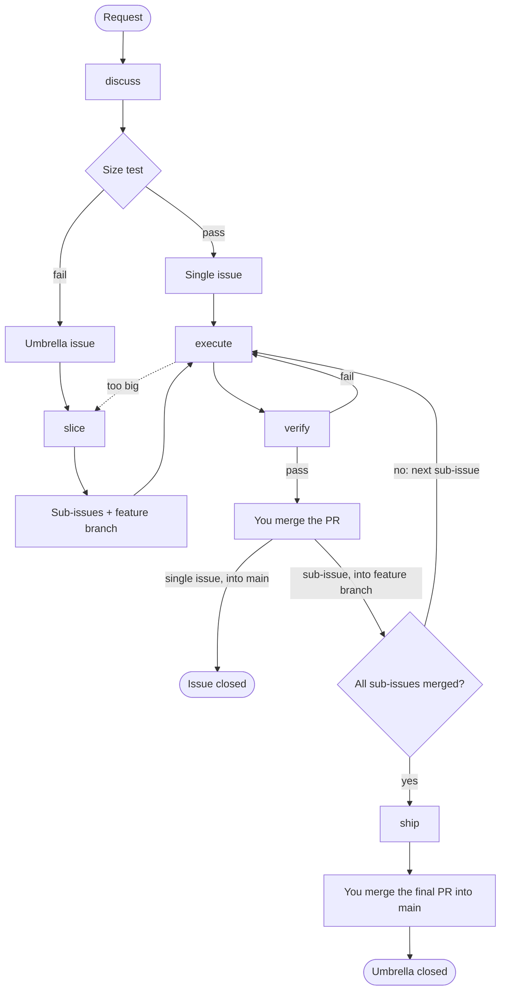

# Engineering

Set up a repo for the plugin, turn a request into GitHub issues, build each one into a verified pull request, and see where each issue stands: setup, discuss, slice, execute, verify, ship, next.

The plugin keeps its record of the work in GitHub: issues, branches and pull requests. discuss and slice write issues only after your yes, and you merge every PR yourself. It works in a local Claude Code session and in a Claude Code cloud session.

## Requirements

- A git repo with a GitHub remote, and `main` as its default branch.
- `gh` installed and authenticated with access to that repo. The skills read and write GitHub mostly through `gh api` REST calls, so they also work in a cloud session, where GraphQL is blocked.
- Squash merge allowed on the repo. Every PR is squash-merged.

## Setup

Install the plugin from this repo's marketplace:

```
/plugin install engineering --marketplace cstalhem/cargus-forge
```

Then run `/engineering:setup` once per repo, from its top folder. Plugin updates reach the repo without a re-run, because the plugin's own rules stay in the plugin.

- It shows what it found on one screen, then asks numbered questions, each with a recommended answer. In an interactive session you answer in a pop-up: `Apply everything recommended`, `Choose item by item` (a yes or no for each question) or `Write nothing`. Setup then writes in the same turn, so its pre-approved commands run without asking again. Where there is no pop-up, as in `claude -p`, answer `yes` to accept them all, `yes, except 2, 4` to decline some, or `no` to decline them all. You can also change a proposal, such as a row of the commands table, and setup shows it again before it writes anything.
- After your yes, it writes the repo profile, which is only `docs/agents/commands.md`: the build, test and lint commands it detected. The plugin takes `main` as the default branch, so the profile does not record it.
- It offers each optional behaviour. Today that is the close-sub-issue workflow, which closes a sub-issue as soon as its PR merges into the feature branch.
- On an existing repo, it reports what differs from the plugin's process, such as other branch names or conflicting docs, and offers one issue that lists them.
- It commits, pushes and labels nothing. It lists the files it wrote, and you commit them on a branch and open a PR.

## Commands

| Command | What it does |
|---|---|
| `/engineering:setup` | Writes the repo profile and turns on optional behaviours. |
| `/engineering:discuss <request or #issue>` | Shapes a request into one issue through question rounds: a single issue if it passes the size test, or an umbrella issue if it does not. |
| `/engineering:execute <#issue>` | Builds one issue on its branch until its verify command passes, then opens a draft PR. |
| `/engineering:next` | Shows where each open issue stands, from its body, links, branches and PRs, and suggests one next command. |
| `/engineering:ship <#umbrella issue>` | Takes an umbrella issue's feature branch to a ready final PR into `main`. |

Two more skills run only when another skill calls them:

- `slice` splits an umbrella issue into sub-issues and creates its feature branch. discuss calls it, and execute calls it on a sub-issue that turns out too big.
- `verify` grades a PR against its issue's scenarios with a fresh-context agent and marks a passing PR ready. execute and ship call it.

discuss and execute read `references/domain-model.md` in their Load step. It holds the rules that keep the repo's domain terms in `docs/glossary.md`.

## Process overview



**Shape** turns a request into issues. discuss asks questions until none is left, with a recommended answer for each. It then runs the size test: an issue fits one session when it delivers one behaviour, one verify command proves it, every file it changes can be named, and no design question is open. Work that passes becomes a single issue. Work that fails becomes an umbrella issue, which slice splits into sub-issues that each pass, on a feature branch.

**Build** takes one issue to a merged PR. execute builds the issue and opens a draft PR. verify grades the PR against the issue's scenarios and marks it ready on a pass. You review and merge it: a single issue's PR into `main`, a sub-issue's PR into the feature branch. Once every sub-issue has merged, ship opens the final PR that takes the feature branch into `main`.

Run `/engineering:next` at any point to see where things stand and what to run next. The process terms are defined in the [glossary](../../docs/glossary.md).

## Status

`/engineering:next` works out each open issue's status from its body, links, branches and PRs, and reads no label. An open issue whose body has neither a `## Scenarios` nor a `## Goal` section is a request that discuss has not shaped yet. A ready issue with an open blocker shows as blocked in `/engineering:next`.
