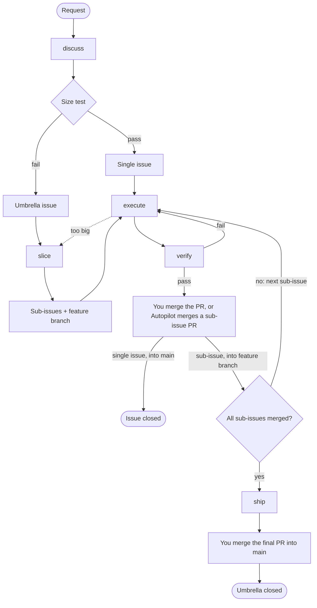

# Engineering

Set up a repo for the plugin, turn a request into GitHub issues, build each one into a verified pull request, let Autopilot build ready issues unattended, have agents study the whole repo for simplifications with anneal, and see where each issue stands: setup, discuss, slice, execute, verify, ship, next, autopilot-t3, anneal.

The plugin keeps its record of the work in GitHub: issues, branches and pull requests. discuss and slice write issues only after your yes. You merge every PR into `main` yourself; when you turn [Autopilot](#autopilot) on, it merges sub-issue PRs into their feature branch for you. The skills run in T3 Code threads.

## Requirements

- A git repo with a GitHub remote, and `main` as its default branch.
- `gh` installed and authenticated with access to that repo. The skills run in T3 Code threads and reach GitHub through `gh`.
- Squash merge allowed on the repo. Every PR is squash-merged.

## Setup

Install the plugin from this repo's marketplace:

```
/plugin install engineering --marketplace cstalhem/cargus-forge
```

Then run `/engineering:setup` once per repo, from its top folder. Plugin updates reach the repo without a re-run, because the plugin's own rules stay in the plugin.

- It shows what it will write, then what it found but will not change, on one screen, then asks numbered questions, each with a recommended answer. In an interactive session you answer in a pop-up: `Apply everything recommended`, `Choose item by item` (a yes or no for each question) or `Write nothing`. Setup then writes in the same turn, so its pre-approved commands run without asking again. Where there is no pop-up, as in `claude -p`, answer `yes` to accept them all, `yes, except 2, 4` to decline some, or `no` to decline them all. You can also change a proposal, such as a row of the commands table, and setup shows it again before it writes anything.
- After your yes, it writes the repo profile, which is only `docs/agents/commands.md`: the build, test and lint commands it detected. The plugin takes `main` as the default branch, so the profile does not record it.
- When the repo has no `.claude/rules/` files, it proposes rules for `.claude/rules/` from the repo's docs, its tool configs and the stack, as one line each with its source, and writes the accepted ones as `.claude/rules/<area>.md`. For the stack it researches the web: one research agent for each component, at most four, in parallel, each returning findings with the URL of its docs, which show as `docs: <url>`. Without network access the agents return `no network`, and setup says so and proposes rules from what the model knows, as `proposed`. A candidate that one command can check becomes a pre-PR check row of the repo profile instead. A repo that already has rules keeps them: setup reports `.claude/rules/` as kept and asks nothing.
- It offers each optional behaviour. Today that is the close-sub-issue workflow, which closes a sub-issue as soon as its PR merges into the feature branch.
- On an existing repo, it reports each finding, something that differs from the plugin's process, such as a repo setting that differs or docs that the plugin cannot see, and gives the action you can take. It leaves each finding as it is, and offers one issue that lists them all.
- It commits, pushes and labels nothing. It lists the files it wrote, and you commit them on a branch and open a PR.

## Commands

| Command | What it does |
|---|---|
| `/engineering:setup` | Writes the repo profile and the rules in `.claude/rules/`, and turns on optional behaviours. |
| `/engineering:discuss <request or #issue>` | Shapes a request into one issue through question rounds: a single issue if it passes the size test, or an umbrella issue if it does not. The turn discuss is typed in runs on Fable, and it covers loading, reading the code and the challenge round; later rounds run on the session's model, and starting the session with `/model fable` keeps all of discuss on Fable. |
| `/engineering:execute <#issue>` | Builds one issue on its branch until its verify command passes, then runs a reflect step that adds the rules and the checks that the work proved, in a draft PR it opens after its first commit. |
| `/engineering:next` | Compares the open issues' bodies, statuses and links for shared files, conflicting goals and dependencies, and recommends one next command and why, with the order of the issues that relate. |
| `/engineering:ship <#umbrella issue>` | Takes an umbrella issue's feature branch to a ready final PR into `main`. |
| `/engineering:autopilot-t3` | Runs Autopilot once, in a thread on a T3 Code host: proposes its hourly scheduled task on the first run, then builds ready issues unattended. See [Autopilot](#autopilot). |
| `/engineering:anneal` | Has agents study the whole repo by area, and turns each confirmed finding into a fix sub-issue under one umbrella issue, or into a request. See [Anneal](#anneal). |

Two more skills run only when another skill calls them:

- `slice` splits an umbrella issue into sub-issues and creates its feature branch. discuss calls it, and execute calls it on a sub-issue that turns out too big.
- `verify` grades a PR against its issue's scenarios with a fresh-context agent, rates the PR's merge risk, and marks a passing PR ready. execute and ship call it.

discuss and execute read `references/domain-model.md` in their Load step. It holds the rules that keep the repo's domain terms in `docs/glossary.md`. They also read `references/adr.md`, which holds the rules for the repo's ADRs in `docs/adr/`: when a decision earns one, its format, and when to edit an existing ADR instead of writing a new one. discuss records each ADR as an `ADR` decision in the issue, execute writes it, and verify grades it.

execute, setup, anneal and verify inject `references/repo-rules.md`, which defines once what a rule is, the rule test, when a rule goes, and when and how a rule gets a backing skill in `.claude/skills/`. It works in a repo with no rules, skills or glossary yet.

## Process overview



**Shape** turns a request into issues. discuss asks questions until none is left, with a recommended answer for each. It then runs the size test: an issue fits one session when it delivers one behaviour, one verify command proves it, every file it changes can be named, and no design question is open. Work that passes becomes a single issue. Work that fails becomes an umbrella issue, which slice splits into sub-issues that each pass, on a feature branch.

**Build** takes one issue to a merged PR. execute opens a draft PR after its first commit and builds the issue on it. verify grades the PR against the issue's scenarios and marks it ready on a pass, and its comment opens with a merge risk level of low, medium or high, which changes no verdict and no ready mark. You review and merge a single issue's PR into `main`. A sub-issue's PR goes into the feature branch: you merge it, or Autopilot does when it is on. Once every sub-issue has merged, ship opens the final PR that takes the feature branch into `main`, and you review and merge that one.

**While CI is still running**, verify gives a PENDING verdict and keeps the PR a draft. execute then schedules its own resume, 10 minutes ahead and at most three times in a row, so no one has to run it again and an Autopilot child keeps its claim on the issue. The resume is a one-time `schedule_task` bound to the thread, which needs a T3 Code build with one-time scheduled tasks (v0.1.7, or a nightly from 2026-11-01 on). On an older T3 Code build, execute stops and says so. After the third resume, and in a session with no `schedule_task` tool, it stops and you run `/engineering:execute <#issue>` again once CI has finished.

Run `/engineering:next` at any point to see where things stand and what to run next. The process terms are defined in the [glossary](../../docs/glossary.md).

## Autopilot

Autopilot is the unattended Build runner. You shape requests in discuss and review PRs into `main`; Autopilot does everything between: it builds each ready issue and each sliced umbrella issue in child threads until a single issue's PR or the final PR is ready for your review. `/engineering:autopilot-t3` runs it once, on a [T3 Code](https://github.com/pingdotgg/t3code) host: a machine that runs `t3` as a service, with this repo as one of its projects. A T3 scheduled task starts each hourly run as a fresh thread in its own worktree, each child is a thread in its own worktree, and the `t3-code` MCP tools, which T3 gives every thread, start the children and read their reports.

### Preparing the host

1. Install T3 Code and run `t3` as a service, so the host runs scheduled tasks while no one watches it.
2. Run `gh auth login` on the host as the user that runs `t3`, with access to the repo. The skills read and write GitHub through `gh api`.
3. Install the plugin on the host: `claude plugin marketplace add cstalhem/cargus-forge` and `claude plugin install engineering@cargus-forge`. Each run checks with `claude plugin list` that an installed copy is there, because a child thread loads the plugin from it, and stops with these two commands otherwise. The plugins synced from claude.ai do not reach a thread that T3 starts.
4. Add the repo as a T3 project, with `main` as its base ref. Each run and each child works in a worktree from `main` on the remote.
5. In the project's settings, set the worktree cleanup to remove settled worktrees. The hourly run and every child are threads in their own worktrees, so the cleanup keeps the host from filling up.

Then open a thread on the project and run `/engineering:autopilot-t3`, on the model and in the runtime mode you want for the hourly run: the scheduled task inherits both from the thread that creates it. The first run finds no scheduled task and proposes one; it creates it only after your yes. The scheduled task's settings, as you see them in T3's scheduled tasks list:

| Setting | Value |
|---|---|
| Title | `engineering: autopilot` |
| Schedule | every hour: an interval of 3600000 ms, counted from the moment it was created |
| Each run | a fresh thread in its own worktree from the project's base ref, with the prompt `/engineering:autopilot-t3` |
| Model and modes | this thread's model, runtime mode and interaction mode, inherited when the task was created. The hourly run and each ship child run on them; each execute child runs on Sonnet. |

Pause or delete the scheduled task in that list. A run that finds it paused, or blocked by a policy, says so in one line with the task's title and goes on, so you can drive Autopilot by hand in a thread of your own with the task paused.

### What a run does

Each run renames its thread to `autopilot <ISO timestamp>`, so the hourly runs are told apart in the thread list. It then takes these steps in order, and ends its turn when a step says so:

1. **Plugin.** The run checks with `claude plugin list` that an installed copy of the engineering plugin is on the host, as [Preparing the host](#preparing-the-host) says, and stops with those instructions otherwise.
2. **Children.** A child is a thread titled `execute #<n>` or `ship #<u>`; its title is the claim on that issue. Each child is launched in its own worktree from `main` on the remote, in `full-access` runtime mode, because no one answers an approval prompt unattended. While a child is working, the run starts nothing and ends. Right after the launch, the child gets one queued message that tells it to report to the run's thread when its work ends: `<title>: finished`, `<title>: stopped on a question` or `<title>: stopped: <reason>`, with the PR and, for a question, its recommended answer. The report arrives as a message in the run's thread and starts the next run. A child whose typed prompt did not load as a skill reports `<title>: stopped: engineering plugin not loaded in this environment` and does nothing else, and Autopilot hands the issue off. A child that stopped on a question gets an answer, through its pending request and a queued message that starts with `Autopilot: answer <k> of 3`: the child's recommended answer, or the answer that changes no scenario and no decision of the issue, at most three times. execute records each answer in the PR under `## Deviations` as `Autopilot: <question> → <answer>, because <why>`, and ship gathers those lines into the final PR, so you read them at review. A child whose verify passed but could not mark its PR ready gets the PR marked ready by Autopilot.
3. **Merge.** Autopilot squash-merges each sub-issue PR that verify marked ready, one at a time, and reads back that it merged. It merges nothing else: a single issue's PR and a final PR wait for you, and execute, verify and ship still merge nothing.
4. **Review.** A ready single-issue PR or final PR without an `Autopilot: ready for your review` comment gets one. Review runs before Ship and Execute, so a run hands a ready PR off before it starts the next child, and it reads the open final PR of every umbrella issue whose sub-issues are all done, whether or not the umbrella issue has a ship child.
5. **Ship.** When every sub-issue of an umbrella issue is done and Review found no open final PR for it, Autopilot starts a child `ship #<u>`. A ship child inherits the run's model.
6. **Execute.** When no child is working, Autopilot starts one child `execute #<n>` for the first issue under `### Ready to build` in `/engineering:next`'s report, so sub-issues run one at a time in blocked-by order. The child runs on the current Sonnet model of the run's provider, because execute is nearly all the tokens and a sized sub-issue does not need the strongest model.

In short, Autopilot merges each ready sub-issue PR, comments on a ready single-issue PR or final PR, then starts ship and execute children one at a time. A run reads the facts and does the Build work that is due, so a lost report or a missed answer waits at most one hour. Autopilot keeps no state of its own: the threads it starts, the comments it posts and `status.sh` are its record.

T3 Connect sends the push notifications: it pushes to your devices when a thread finishes, fails or asks, so the run sends none of its own.

### The three hand-offs

A hand-off is one comment, and the comment is the record: Autopilot never hands the same thing off twice. `<title>` is the child's title and `<thread>` its thread id. Children run in `full-access` mode, so no child waits on a permission prompt.

| Hand-off | Comment | Where |
|---|---|---|
| A child asks a fourth question after three answers | `Autopilot: stopped, <title> (<thread>) asked a fourth question after three answers: <question>` | the issue |
| A child stopped for another reason, such as execute sending a single issue back to discuss, or the engineering plugin not loaded in the child | `Autopilot: stopped, <title> (<thread>) stopped: <reason>` | the issue |
| A single issue's PR or a final PR is ready | `Autopilot: ready for your review: PR #<pr>, <title>, for #<n>.` | the PR |

Open the thread the comment names in T3 Code to see what the child did, answer it there, or fix the issue and run `/engineering:execute #<n>` yourself.

## Anneal

An anneal makes the repo simpler for the next change, with the same behaviour for users. You start each one by hand with `/engineering:anneal`; a scheduled anneal is a later request, once hand-started runs have shown that its routes can be trusted. It asks no question, and changes no file in the repo: it writes only GitHub issues and one feature branch.

An anneal does this:

1. It stops unless `HEAD` is the same commit as `origin/main` after a fetch.
2. It reads `CLAUDE.md`, `.claude/rules/`, `docs/adr/`, `docs/glossary.md` and the repo's files, and picks at most six areas.
3. It starts one investigator on Opus for each area, in parallel. Each returns at most five findings: a title, `file:line`, the change, why it is simpler, and the rule that would have made the fix unneeded. Bold rewrites are welcome, and no alternative an ADR rejects is proposed.
4. It checks each finding with a fresh Sonnet agent that returns confirmed, corrected or refuted, and keeps a rule only when the code before the fix breaks it and the code after follows it.
5. It merges related findings and routes each one. A **fix** keeps behaviour the same, passes the size test and has a verify command that fails before the work. A **request** is any other confirmed finding, every bold rewrite included. A refuted finding is dropped.
6. It writes each request as an issue titled `Anneal <date> · <area>: <title>`, with no `## Scenarios`, for `/engineering:discuss` to shape. When at least one finding is a fix, it also writes an umbrella issue `Anneal <date>`, the feature branch `<umbrella>-anneal-<date>`, and one sub-issue for each fix, with its rule as a scenario.
7. It shows each URL, the count of findings for each area and route, and the next step.

Autopilot builds the umbrella issue like any other, with no discuss. You can also run `/engineering:execute` on its first sub-issue by hand. The final PR into `main` is your review of the whole anneal.

## Status

`/engineering:next` works out each open issue's status from its body, links, branches and PRs, and reads no label. An open issue whose body has neither a `## Scenarios` nor a `## Goal` section is a request that discuss has not shaped yet, and so is an open issue whose author is not a trusted author (`author_association` OWNER, MEMBER or COLLABORATOR), whatever its body says: discuss shapes it into a new issue that you write, and a PR or comment by anyone else gives `status.sh` and Autopilot no fact. A ready issue with an open blocker shows as blocked in `/engineering:next`. To recommend an order, it also reads a filtered copy of each open issue's body from `bodies.sh`: the `## What it delivers` and `## Files` sections, or the `## Goal` and `## Out of scope` sections, cut to a share of 24,000 characters in all.

To browse on GitHub, `labels.sh` keeps the green label `engineering:shaped` on each open issue that discuss has finished, so you see which issues to leave to Build. It removes the label from each open request, and leaves closed issues alone. `/engineering:next` and Autopilot run it, and it creates the label when the repo lacks it. No skill reads the label, and `labels.sh` changes no other label. The old labels `engineering:needs-discussion`, `status:ready`, `status:in-progress`, `status:needs-review` and `umbrella` do nothing now: delete them by hand from the repo's Labels page, which also removes them from every issue.
